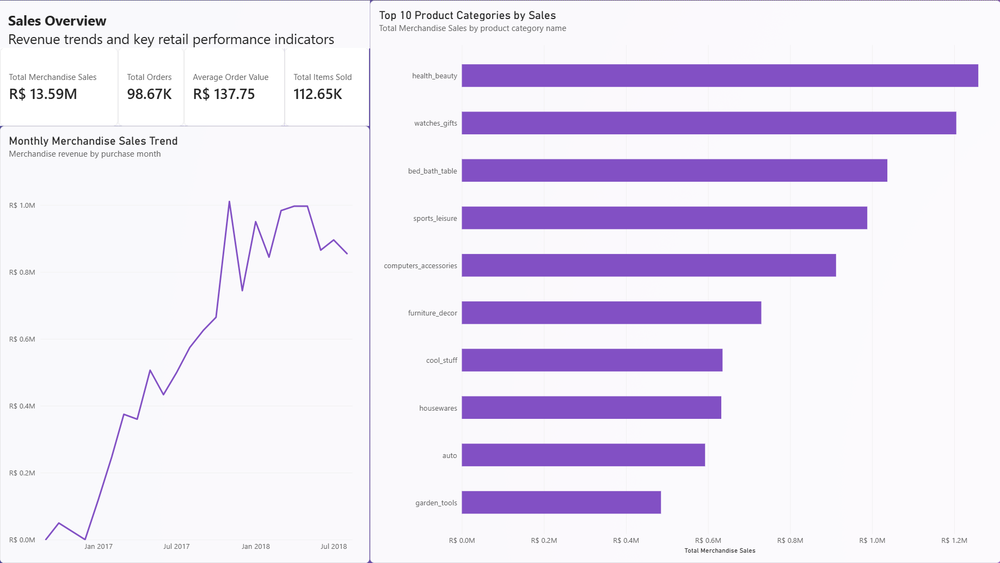
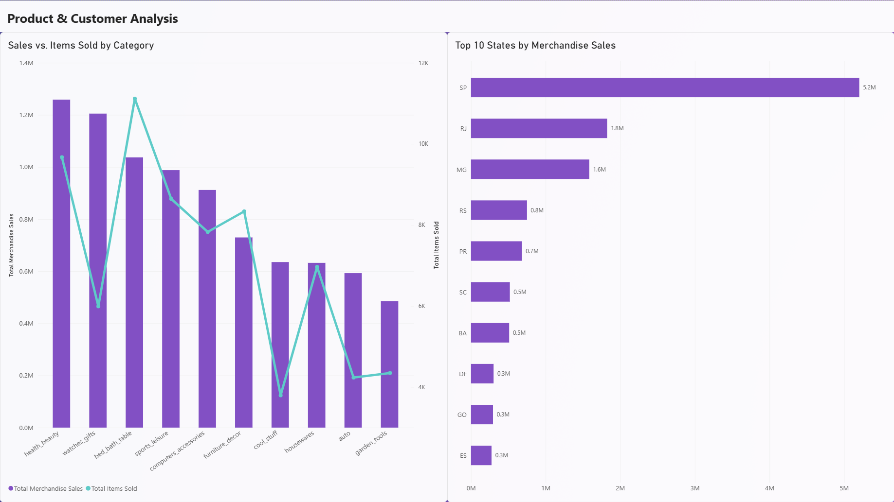
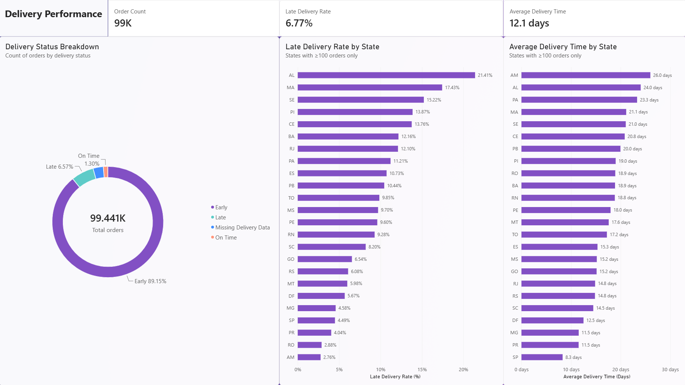
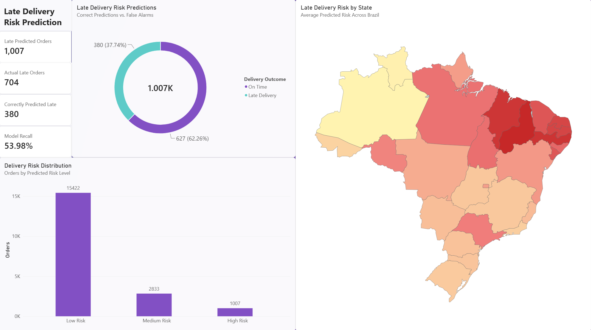

# Retail Business Intelligence & Analytics Platform

## Overview

An end-to-end business intelligence and analytics project that transforms raw retail data into actionable business insights using Python, PostgreSQL, SQL, Power BI, and machine learning.

Built using the Brazilian E-Commerce Public Dataset by Olist, the project covers data exploration, data cleaning, relational database development, dimensional modelling, SQL analysis, interactive dashboards, and predictive analytics.

The platform also integrates a machine learning model into Power BI to identify orders at risk of late delivery, demonstrating how predictive analytics can support operational decision-making.

## Project Objectives

- Analyze retail sales, customer behaviour, product performance, and delivery operations.
- Build a reproducible data preparation workflow using Python and Pandas.
- Store and manage relational datasets using PostgreSQL.
- Develop analytical SQL queries and dimensional data models.
- Design interactive Power BI dashboards and business KPIs using DAX.
- Train and evaluate a machine learning model to predict late deliveries.
- Integrate machine learning predictions into Power BI for business reporting.
- Explore opportunities for automated reporting and operational alerts.

## Dataset

This project uses the **Brazilian E-Commerce Public Dataset by Olist**, containing approximately 100,000 anonymized orders placed in Brazil between 2016 and 2018.

The dataset contains multiple related files covering customers, orders, order items, products, sellers, payments, reviews, and geographic information.

### Data Source

**Brazilian E-Commerce Public Dataset by Olist**

https://www.kaggle.com/datasets/olistbr/brazilian-ecommerce

The original dataset is not included in this repository. Raw datasets are maintained locally to keep the repository focused on source code, analytical models, documentation, and outputs.

### Dataset Setup

To reproduce the project:

1. Download the dataset from Kaggle.
2. Extract the downloaded archive.
3. Place the CSV files inside the `data/raw/` directory.

```text
data/raw/
├── olist_customers_dataset.csv
├── olist_geolocation_dataset.csv
├── olist_order_items_dataset.csv
├── olist_order_payments_dataset.csv
├── olist_order_reviews_dataset.csv
├── olist_orders_dataset.csv
├── olist_products_dataset.csv
├── olist_sellers_dataset.csv
└── product_category_name_translation.csv
```

## Technologies

| Category | Technologies |
|----------|--------------|
| Programming | Python |
| Data Processing | Pandas, NumPy |
| Database | PostgreSQL, SQL |
| Data Modelling | Relational and Dimensional Modelling |
| Business Intelligence | Power BI, Power Query, DAX |
| Machine Learning | scikit-learn, Gradient Boosting |
| Development Tools | Jupyter Notebook, Git, GitHub |

## Project Architecture

The project follows a structured analytics workflow, transforming raw transactional data into business intelligence reports and predictive insights.

```text
Brazilian E-Commerce Dataset (Olist)
                 |
                 v
        Python Data Preparation
       (Cleaning & Transformation)
                 |
                 v
          PostgreSQL Database
                 |
          +------+------+
          |             |
          v             v
     SQL Analysis   Dimensional Model
          |             |
          +------+------+
                 |
                 v
          Power BI Reports
                 |
                 v
          Business Insights


      Historical Order Data
                 |
                 v
      Feature Engineering
                 |
                 v
     Gradient Boosting Model
                 |
                 v
      Late Delivery Predictions
                 |
                 v
       Power BI Integration
                 |
                 v
      Delivery Risk Dashboard
```

The predictive analytics workflow uses historical order information available at carrier handoff to estimate late-delivery risk.

## Repository Structure

```text
data/              Raw and processed datasets (stored locally)
docs/              Project documentation
machine_learning/  Late-delivery prediction notebook and ML workflow
notebooks/         Data exploration, cleaning, and transformation
powerbi/           Power BI reports and documentation
psql/              PostgreSQL command-line setup and documentation
screenshots/       Dashboard and project screenshots
sql/               Database schema and analytical SQL queries
```

## Data Preparation

Python and Pandas are used to explore, clean, and prepare the Olist datasets for analysis.

The data preparation workflow focuses on:

- Identifying missing values and duplicate records.
- Validating data types and date columns.
- Examining relationships between transactional tables.
- Preparing datasets for PostgreSQL.
- Supporting reproducible data transformation and analysis.

The cleaned datasets provide a foundation for relational modelling, SQL analysis, and business intelligence development.

## PostgreSQL Database & SQL Analysis

PostgreSQL serves as the relational database for the analytics platform.

The database contains related tables representing orders, customers, products, sellers, payments, and other retail operations.

### Analytical Data Model

The Power BI reporting model uses dimensional modelling concepts, including:

- `dim_date` — Date dimension for time-based analysis.
- `fact_order_items` — Order-item-level fact table for sales analysis.
- Supporting order, customer, product, and seller tables.

Relationships between these tables enable analysis across multiple business dimensions.

### SQL Business Analysis

SQL is used to explore retail performance and answer business questions related to:

- Sales and revenue trends.
- Order volumes and average order value.
- Product category performance.
- Customer purchasing behaviour.
- Geographic sales distribution.
- Delivery performance and operational efficiency.

These analyses support the KPIs and visualizations developed in Power BI.


## Power BI Business Intelligence

Four interactive Power BI report pages were developed to analyze retail performance and predictive delivery risk.

### 1. Sales Overview

Provides a high-level overview of retail sales performance.

**Key Features:**
- Total sales, total orders, and average order value.
- Monthly sales trends.
- Product category performance.
- Interactive filtering and KPI monitoring.



### 2. Product & Customer Analysis

Explores customer purchasing patterns and product performance.

**Key Features:**
- Product category comparisons.
- Customer and geographic analysis.
- Purchasing behaviour and sales distribution.
- Interactive visualizations for identifying business opportunities.



### 3. Delivery Performance

Analyzes historical order fulfilment and delivery performance.

**Key Features:**
- Late-delivery rates.
- Delivery time analysis.
- Geographic delivery performance.
- Order status and operational trends.



### 4. Late Delivery Risk Prediction

Integrates machine learning predictions into Power BI to identify orders with elevated late-delivery risk.

**Key Features:**
- KPI cards for predicted late orders, actual late orders, correctly identified late orders, and model recall.
- Donut chart comparing correct late-delivery alerts and false alarms.
- Column chart showing predicted risk categories.
- Geographic map displaying average predicted delivery risk across Brazilian states.
- A 15% prediction threshold used to classify potentially late orders.


For dashboard development, data modelling, and DAX implementation details, see the [Power BI Documentation](powerbi/README.md).

## Machine Learning: Late Delivery Prediction

Developed a machine learning model to identify orders at risk of late delivery using information available at carrier handoff.

The model uses **14 engineered features** and scikit-learn's `HistGradientBoostingClassifier`, with chronological training, validation, and test splits.

### Model Performance

Evaluated on **19,262 historical test orders** using a **15% classification threshold**.

| Metric | Result |
|--------|--------|
| Accuracy | 95.06% |
| Precision | 37.74% |
| Recall | 53.98% |
| F1 Score | 44.42% |

The model correctly identified **380 of 704 late deliveries**, flagging 1,007 orders as potentially late.

### Power BI Integration

Exported predictions to `late_delivery_predictions.csv` and integrated them into Power BI using an `order_id` relationship.

The predictions support interactive analysis of delivery risk, model performance, and geographic trends.

For implementation details, see the [Late Delivery Prediction Notebook](machine_learning/late_delivery_prediction.ipynb) and the [Power BI Documentation](powerbi/README.md).

## Future Enhancements

- Implement automated KPI reporting and notifications using Microsoft Power Automate.
- Develop operational alerts for orders with elevated predicted delivery risk.
- Evaluate probability calibration and alternative classification thresholds.
- Explore additional features and modelling techniques to improve late-delivery detection.
- Extend the analytics platform with more advanced business forecasting.

## Project Summary

This project demonstrates an end-to-end analytics workflow combining:

- **Data Engineering:** Data preparation, transformation, and relational database development.
- **SQL Analytics:** Business performance analysis and dimensional data modelling.
- **Business Intelligence:** Interactive Power BI dashboards and DAX-based KPIs.
- **Machine Learning:** Feature engineering, classification, model evaluation, and prediction export.
- **Predictive BI:** Integration of machine learning outputs into business reporting.

The resulting platform demonstrates how historical retail data can be transformed into descriptive and predictive insights that support business decision-making.