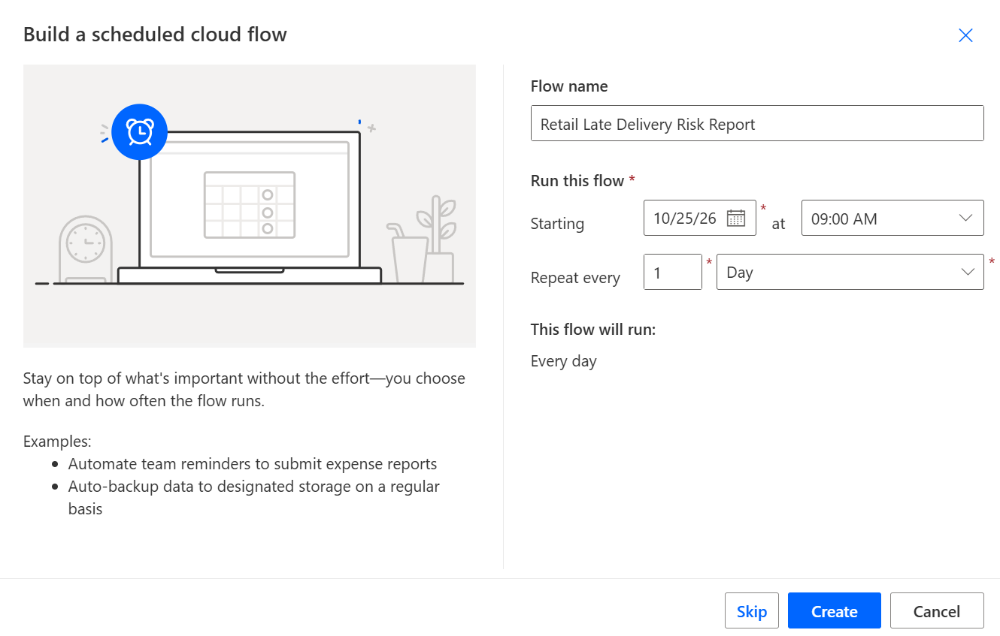
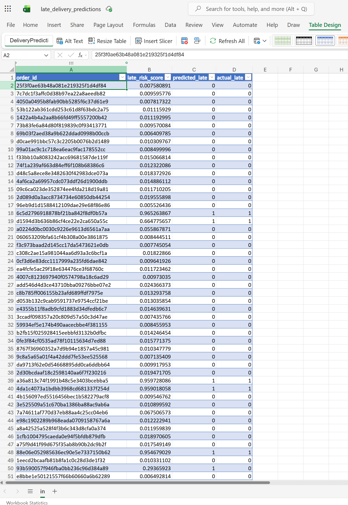
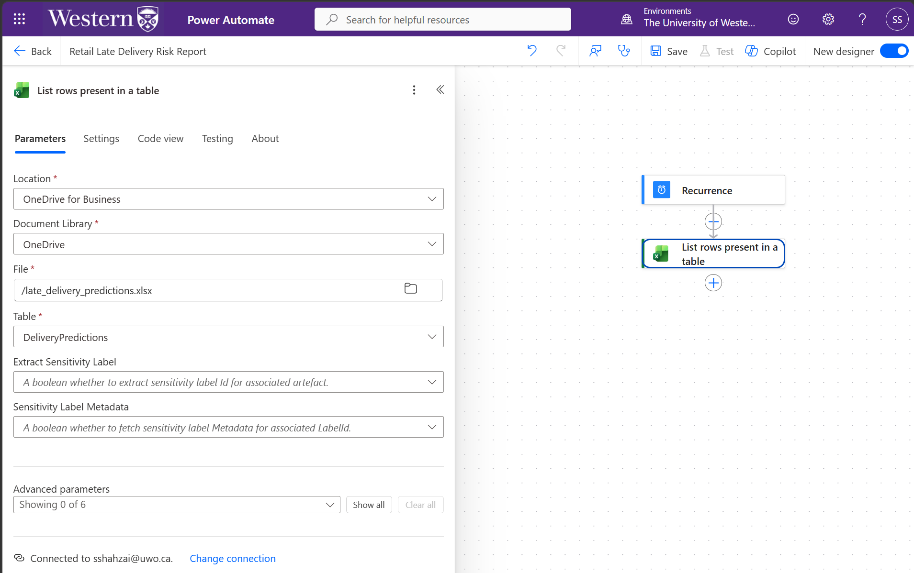

# Power Automate: Late Delivery Risk Reporting

## Overview

This workflow is designed to automate daily reporting of predicted late-delivery risks using Microsoft Power Automate, Excel Online, and Outlook.

The automation uses predictions generated by the project's machine learning model and stored in an Excel table on OneDrive for Business.

## Workflow Architecture

```text
Machine Learning Model (Python)
          |
          v
late_delivery_predictions.csv
          |
          v
Excel Online (OneDrive for Business)
          |
          v
Power Automate (Daily Recurrence)
          |
          v
Read DeliveryPredictions Table
          |
          v
Filter High-Risk Orders (Planned)
          |
          v
Email Risk Summary (Planned)
```

## Implementation

### 1. Scheduled Cloud Flow

Created a scheduled cloud flow named **Retail Late Delivery Risk Report**, configured to run daily.

The recurrence trigger initiates the workflow automatically according to its configured schedule.



### 2. Excel Data Source

Exported the machine learning predictions to `late_delivery_predictions.csv` and converted the dataset into an Excel workbook named `late_delivery_predictions.xlsx`.

The workbook is stored in OneDrive for Business and contains an Excel table named `DeliveryPredictions`.

The table includes four columns:

| Column | Description |
|--------|-------------|
| `order_id` | Unique identifier for each order |
| `late_risk_score` | Predicted probability of late delivery |
| `predicted_late` | Binary classification of predicted delivery risk |
| `actual_late` | Historical delivery outcome |



### 3. Excel Online Connection

Configured the **List rows present in a table** action using the Excel Online (Business) connector.

**Connection configuration:**

| Parameter | Value |
|-----------|-------|
| Location | OneDrive for Business |
| Document Library | OneDrive |
| File | `late_delivery_predictions.xlsx` |
| Table | `DeliveryPredictions` |

This action retrieves prediction records from the Excel workbook for subsequent processing.
Enabled pagination in the Excel Online (Business) action with a threshold of **20,000 rows** to retrieve the complete dataset of 19,262 prediction records, exceeding the default 256-row limit.



## Planned Reporting Logic

### 4. High-Risk Order Filtering

Filter prediction records using the `predicted_late` column.

Orders classified as potentially late (`predicted_late = 1`) will be included in the automated risk report.

The machine learning model uses a **15% classification threshold** to flag potentially late deliveries.

### 5. Automated Email Reporting

Use Outlook to distribute a scheduled delivery-risk summary containing:

- Total number of orders analyzed
- Number of orders flagged as potentially late
- Percentage of orders flagged
- Summary of predicted delivery risks

### 6. Workflow Testing

Validate the automation by:

- Confirming successful Excel data retrieval
- Verifying that risk filtering returns the expected records
- Checking the accuracy of calculated reporting metrics
- Confirming successful email delivery

## Technologies Used

| Technology | Purpose |
|------------|---------|
| Python / scikit-learn | Machine learning predictions |
| Excel Online | Prediction data storage |
| OneDrive for Business | Cloud file storage |
| Power Automate | Workflow scheduling and automation |
| Outlook | Automated email reporting |

## Project Status

**In Progress**

Completed:
- Scheduled cloud flow created
- Machine learning predictions exported to Excel
- Excel table configured
- Excel Online (Business) connection established

Remaining:
- Configure pagination for the full prediction dataset
- Implement high-risk order filtering
- Build automated email reporting
- Test and validate the completed workflow

## Notes

This workflow uses historical e-commerce order data and demonstrates automated reporting rather than real-time delivery monitoring.

The automation reads existing machine learning predictions; it does not automatically retrain or rerun the prediction model.
