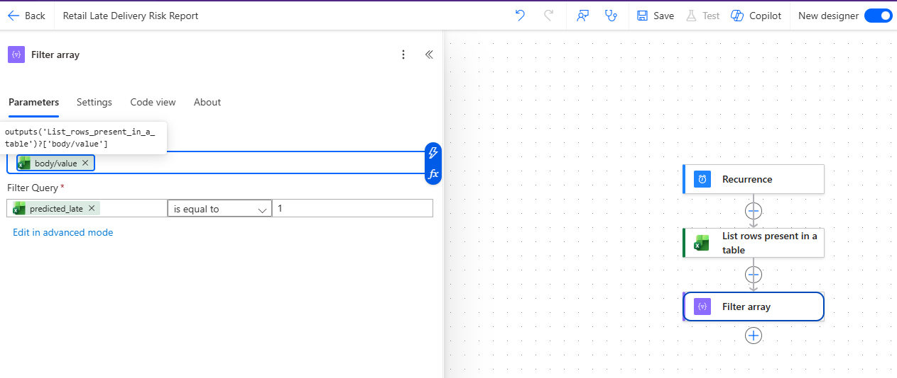
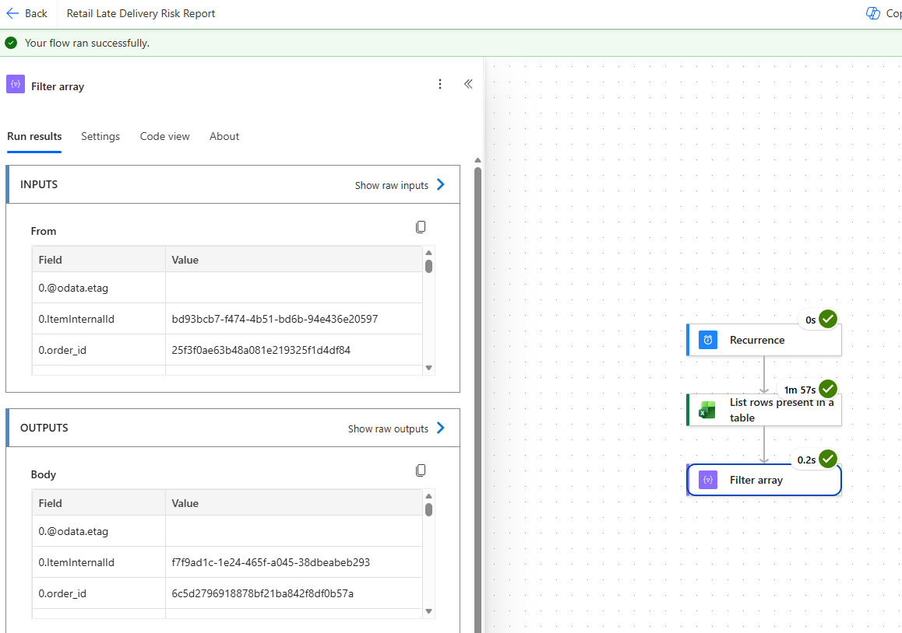
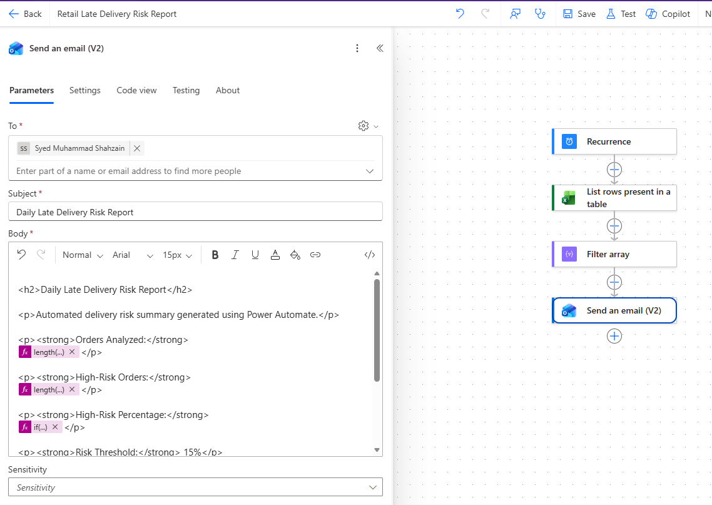
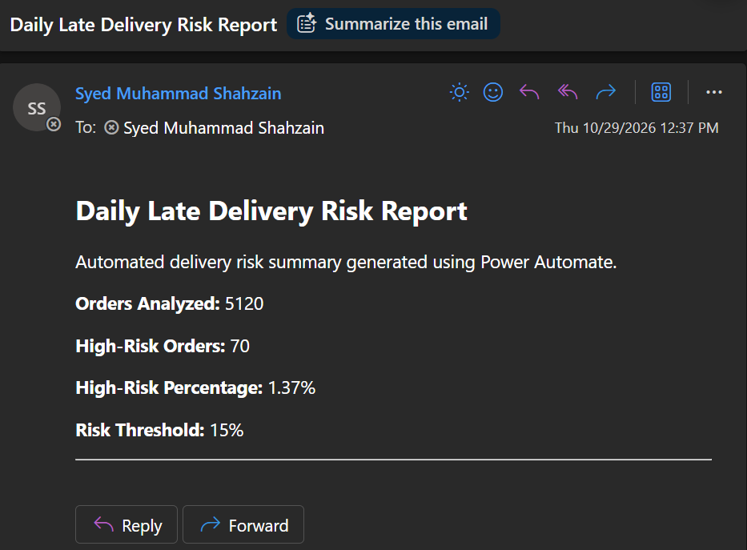

# Power Automate: Late Delivery Risk Reporting

## Overview

This workflow automates daily reporting of predicted late-delivery risks using Microsoft Power Automate, Excel Online, and Outlook.

The automation uses predictions generated by the project's machine learning model and stored in an Excel table on OneDrive for Business.

The workflow retrieves prediction records, identifies high-risk orders, calculates reporting metrics, and sends a formatted HTML email.

## Workflow Architecture

```text
Machine Learning Model (Python)
          |
          v
late_delivery_predictions.csv
          |
          v
Excel Online (OneDrive for Business)
          |
          v
Power Automate (Daily Recurrence)
          |
          v
Read DeliveryPredictions Table
          |
          v
Filter High-Risk Orders
          |
          v
Calculate Risk Metrics
          |
          v
Email Risk Summary (Outlook)
```

## Implementation

### 1. Scheduled Cloud Flow

Created a scheduled cloud flow named **Retail Late Delivery Risk Report**, configured to run daily.

The recurrence trigger initiates the workflow automatically according to its configured schedule.


### 2. Excel Data Source

Exported machine learning predictions to `late_delivery_predictions.csv` and converted the dataset into an Excel workbook named `late_delivery_predictions.xlsx`.

The workbook is stored in OneDrive for Business and contains an Excel table named `DeliveryPredictions`.

The table includes four columns:

| Column | Description |
|--------|-------------|
| `order_id` | Unique identifier for each order |
| `late_risk_score` | Predicted probability of late delivery |
| `predicted_late` | Binary classification of predicted delivery risk |
| `actual_late` | Historical delivery outcome |

The machine learning model uses a **15% classification threshold** to identify potentially late deliveries.


### 3. Excel Online Connection

Configured the **List rows present in a table** action using the Excel Online (Business) connector.

**Connection configuration:**

| Parameter | Value |
|-----------|-------|
| Location | OneDrive for Business |
| Document Library | OneDrive |
| File | `late_delivery_predictions.xlsx` |
| Table | `DeliveryPredictions` |

This action retrieves prediction records from the Excel workbook for subsequent processing.

Pagination was enabled with a configured threshold of **5,000**, the maximum accepted by the university account.

The complete prediction dataset contains **19,262 records**. Additional batching or an alternative data retrieval approach would be required to guarantee complete dataset coverage.


### 4. High-Risk Order Filtering

Configured a **Filter array** action in Power Automate to identify orders predicted to arrive late.

The filter processes records retrieved from the `DeliveryPredictions` Excel table.

**Input:**

```text
body/value
```

**Filter expression:**

```text
@equals(string(item()?['predicted_late']), '1')
```

This expression converts the `predicted_late` value to a string before comparing it with `1`.

The machine learning model uses a **15% probability threshold** to classify potentially late deliveries.

This filtering step prepares high-risk orders for automated email reporting.



### 5. High-Risk Filter Validation

Successfully tested the Power Automate workflow to verify that machine learning predictions are retrieved and filtered correctly.

The test confirmed:

- **Recurrence:** Executed successfully.
- **Excel Online:** Retrieved prediction records from the `DeliveryPredictions` table.
- **Filter array:** Successfully identified orders where `predicted_late = 1`.
- **Execution time:** Approximately 2 minutes during initial testing.

The filtering condition handles Excel values returned as strings.



**Result:** High-risk order filtering validated successfully.

### 6. Automated Email Reporting

Configured the **Send an email (V2)** action using the Office 365 Outlook connector to generate scheduled late-delivery risk summaries.

The email report includes:

- **Orders Analyzed:** Total prediction records retrieved from Excel.
- **High-Risk Orders:** Number of orders flagged by the machine learning model.
- **High-Risk Percentage:** Percentage of analyzed orders classified as high-risk.
- **Risk Threshold:** 15% probability of late delivery.

#### Power Automate Expressions

**Total Orders Analyzed:**

```text
length(body('List_rows_present_in_a_table')?['value'])
```

**High-Risk Orders:**

```text
length(body('Filter_array'))
```

**High-Risk Percentage:**

```text
if(equals(length(body('List_rows_present_in_a_table')?['value']),0),'N/A',concat(formatNumber(mul(div(float(length(body('Filter_array'))),float(length(body('List_rows_present_in_a_table')?['value']))),100),'0.00'),'%'))
```

The percentage calculation includes a check to avoid division by zero when no records are retrieved.

#### Email Body (HTML)

The following HTML template is used in the Power Automate email action:

```html
<h2>Daily Late Delivery Risk Report</h2>

<p>Automated delivery risk summary generated using Power Automate.</p>

<p><strong>Orders Analyzed:</strong>
@{length(body('List_rows_present_in_a_table')?['value'])}</p>

<p><strong>High-Risk Orders:</strong>
@{length(body('Filter_array'))}</p>

<p><strong>High-Risk Percentage:</strong>
@{if(equals(length(body('List_rows_present_in_a_table')?['value']),0),'N/A',concat(formatNumber(mul(div(float(length(body('Filter_array'))),float(length(body('List_rows_present_in_a_table')?['value']))),100),'0.00'),'%'))}</p>

<p><strong>Risk Threshold:</strong> 15%</p>

<hr>
```

The email uses HTML formatting and Power Automate expressions to calculate and display reporting metrics dynamically.



### 7. Email Delivery Validation

Successfully tested the automated reporting workflow.

The Power Automate flow retrieved prediction records from Excel, filtered high-risk orders, calculated summary metrics, and delivered a formatted HTML email through Outlook.

**Test Results — October 29, 2026:**

| Metric | Result |
|--------|--------|
| Orders Analyzed | 5,120 |
| High-Risk Orders | 70 |
| High-Risk Percentage | 1.37% |
| Risk Threshold | 15% |
| Email Delivery | Successful |
| HTML Formatting | Verified |

The reported high-risk percentage is calculated as:

```text
(70 / 5120) * 100 = 1.37%
```

The successful test confirmed that the workflow can:

- Retrieve machine learning predictions from Excel Online.
- Filter orders classified as high-risk.
- Calculate reporting metrics dynamically.
- Generate a formatted HTML email.
- Deliver the report through Outlook.



**Status:** Email delivery and HTML formatting verified successfully.

## Technologies Used

| Technology | Purpose |
|------------|---------|
| Python / scikit-learn | Machine learning predictions |
| Excel Online | Prediction data storage |
| OneDrive for Business | Cloud file storage |
| Power Automate | Workflow scheduling and automation |
| Outlook | Automated email reporting |
| HTML | Email formatting |

## Project Status

**Status: Implemented and Tested**

### Completed

- Scheduled cloud flow created.
- Machine learning predictions exported to Excel.
- Excel table configured in OneDrive for Business.
- Excel Online (Business) connection established.
- Pagination configured.
- High-risk order filtering implemented.
- Filter logic tested and validated.
- Dynamic reporting metrics implemented.
- Automated HTML email configured.
- Email delivery and formatting successfully tested.

### Future Improvements

- Implement batching or an alternative data retrieval method to process all 19,262 prediction records.
- Investigate the difference between the configured pagination threshold and the 5,120 records reported during testing.
- Include individual high-risk order details in the email.
- Automate refreshing prediction data from the machine learning pipeline.
- Add workflow error handling and failure notifications.

## Notes

This workflow uses historical e-commerce order data and demonstrates automated reporting rather than real-time delivery monitoring.

The automation reads existing machine learning predictions; it does not automatically retrain or rerun the prediction model.

The reporting metrics reflect the records retrieved during each execution, not necessarily the complete historical dataset.
