# Power BI

Power BI is used as the reporting and visualization layer for the Retail Business Intelligence & Analytics Platform.

## Data Pipeline

```text
PostgreSQL → Power Query → Data Model → DAX → Dashboard
```

## PostgreSQL Connection

Power BI connects directly to the local `retail_bi` PostgreSQL database using **Import mode**.

```text
Server: localhost
Database: retail_bi
Connectivity Mode: Import
```

The local development connection uses an unencrypted `localhost` connection. Production environments should use properly configured TLS encryption.

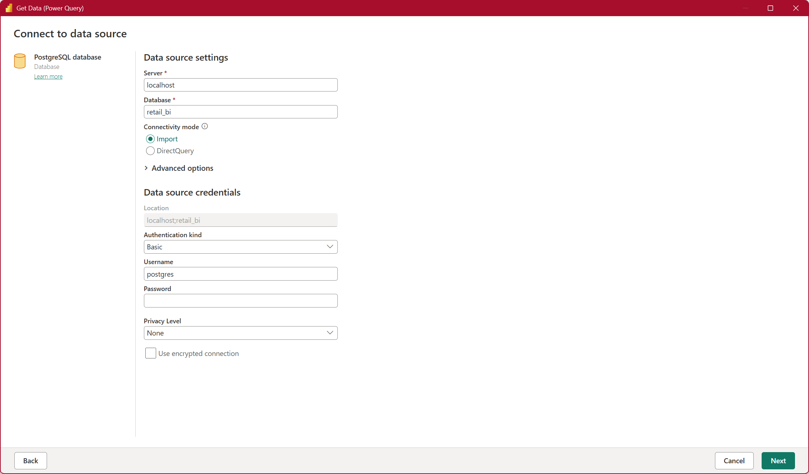

## Data Selection

The initial Power BI model imports:

- `customers`
- `dim_date`
- `fact_order_items`
- `orders`
- `products`
- `sellers`

`order_items` is not imported because the required item-level sales data is already represented by `fact_order_items`.

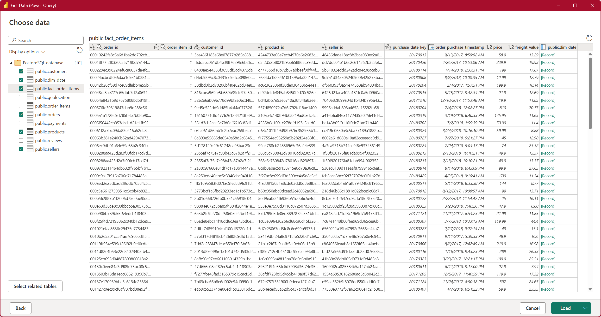

## Data Model Relationships

Power BI relationships allow filters and calculations to work across related tables.

```text
products.product_id (1) → (*) fact_order_items.product_id
```

This is a **one-to-many relationship** with **single-direction filtering** from the dimension to the fact table.

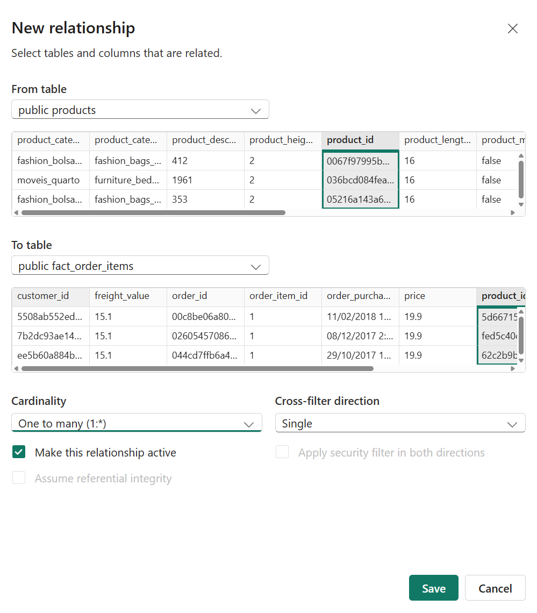

This Power BI model uses five active relationships:

| From (1) | To (*) |
|---|---|
| `products.product_id` | `fact_order_items.product_id` |
| `sellers.seller_id` | `fact_order_items.seller_id` |
| `dim_date.date_key` | `fact_order_items.purchase_date_key` |
| `orders.order_id` | `fact_order_items.order_id` |
| `customers.customer_id` | `orders.customer_id` (1:1) |

Relationships enable filtering across customers, orders, products, sellers, and sales while avoiding duplicate filtering paths.

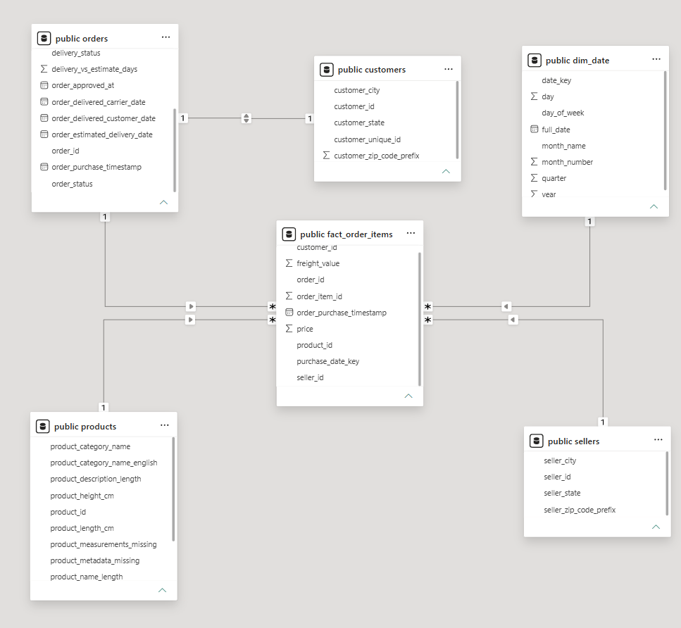

**Customer Relationship Note:** In the Olist dataset, `customer_id` is unique to each order's customer record, making the Customers → Orders relationship 1:1. However, `customer_unique_id` identifies the same real customer across multiple orders and is used for repeat-customer analysis.

## Power Query

Created a `purchase_date` column in the `orders` table by duplicating `order_purchase_timestamp` and converting it to **Date Only**.

- **Original:** `2017-10-02 10:56:33`
- **Transformed:** `2017-10-02`

This preserves the original timestamp while providing a date-only column for daily reporting. The transformation is automatically reapplied during data refreshes.

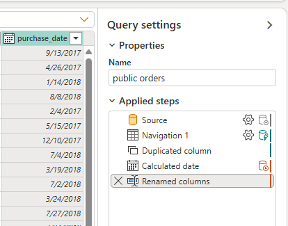

## Data Model

*To be documented as the project progresses.*

## DAX Measures
```dax
Total Merchandise Sales = SUM('public fact_order_items'[price])
```
- `SUM()` calculates the total of the `price` column.
This measure represents merchandise sales, excluding freight charges.
- **Validated result:** 13,591,643.70, matching our PostgreSQL analysis.

```dax
Total Orders = DISTINCTCOUNT('public fact_order_items'[order_id])
```
- Counts unique orders without double-counting items.
- **Validated SQL result:** 98,666 orders.

```dax
Average Order Value = DIVIDE([Total Merchandise Sales], [Total Orders])
```
- Calculates average merchandise sales per order using existing measures.
- **Validated SQL result:** 137.75.

```dax
Late Delivery Rate =
DIVIDE(
    CALCULATE(COUNTROWS('public orders'), 'public orders'[delivery_status] = "Late"),
    CALCULATE(COUNTROWS('public orders'), 'public orders'[delivery_status] <> "Missing Delivery Data")
)
```
- Calculates the percentage of late orders, excluding missing delivery data.
- `COUNTROWS()` counts the rows in a table.
- `CALCULATE(what_to_calculate, filter_conditions)` evaluates an expression using specified filters.
- `<>` == not equal to
- **Validated SQL result:** 6.77%.

```dax
Average Delivery Time = AVERAGE('public orders'[delivery_days])
```
- Calculates the average number of days between purchase and delivery.
- `AVERAGE()` calculates the mean of a numeric column, excluding blanks.
- **Validated SQL result:** 12.09 days.

```dax
Total Items Sold = COUNTROWS('public fact_order_items')
```
- Counts the total number of items sold across all orders.
- **Validated SQL result:** 112,650 items.

### Monthly Merchandise Sales

- Line chart showing merchandise sales by year, quarter, and month.
- Uses `dim_date.full_date` and the `Total Merchandise Sales` DAX measure.
- Highlights monthly sales trends across the dataset.

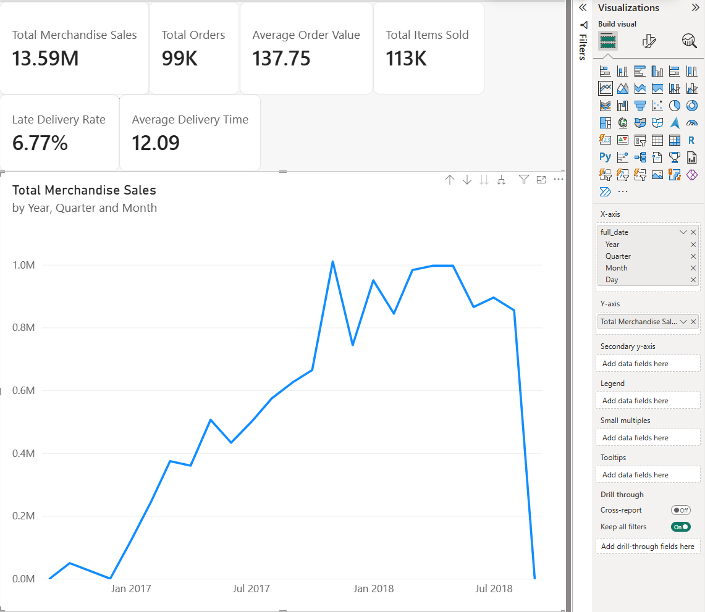

### Top 10 Product Categories by Sales

- Horizontal bar chart ranking the 10 highest-selling product categories.
- Uses `products.product_category_name_english` and the `Total Merchandise Sales` DAX measure.
- Applies a Top N filter to identify leading categories.

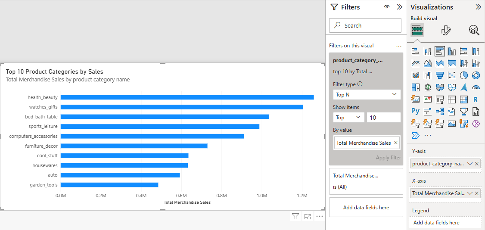

### Average Delivery Time by State

- Horizontal bar chart comparing average delivery time (days) across Brazilian states.
- Uses `customers.customer_state` and the `Average Delivery Time` DAX measure.
- Applied a visual-level filter of `Order Count >= 100` to exclude states with fewer than 100 orders, reducing misleading comparisons caused by small sample sizes.

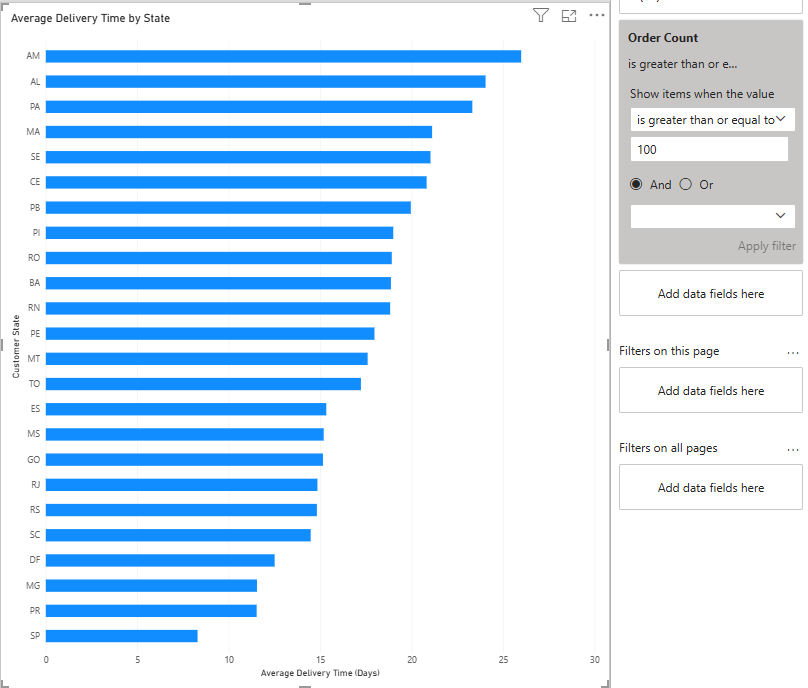

## Dashboard

### Sales Overview Dashboard


- Displays four key performance indicators: Total Merchandise Sales, Total Orders, Average Order Value, and Total Items Sold.
- Visualizes monthly merchandise sales trends to identify revenue growth and fluctuations over time.
- Ranks the top 10 product categories by merchandise sales.
- Uses Brazilian reais (R$) for monetary values.
- Excludes incomplete final-month data from the monthly sales trend using a visual-level date filter, while preserving overall KPI totals.

### Product & Customer Analysis Dashboard


- Compares merchandise sales and items sold across the top 10 product categories using a combination chart.
- Identifies the top 10 Brazilian states by total merchandise sales.
- Uses `Total Orders` as a tooltip to provide additional context for state-level sales.
- Highlights differences between product sales revenue, sales volume, and geographic performance.

### Delivery Performance Dashboard


- Displays total orders, late delivery rate, and average delivery time as KPI cards.
- Visualizes the distribution of early, late, on-time, and missing delivery statuses.
- Compares late delivery rates and average delivery times across Brazilian states.
- Applies a visual-level filter of **Order Count ≥ 100** to both state charts to exclude states with small order volumes.
- Highlights regional differences in delivery reliability and shipping performance.


### Late Delivery Risk Prediction

Integrates Gradient Boosting predictions into Power BI to analyze late-delivery risk across 19,262 historical test orders.

**Key Features:**
- KPI cards for predicted late orders, actual late orders, correctly identified late orders, and model recall.
- Donut chart comparing correct alerts and false alarms.
- Column chart showing low, medium, and high delivery risk.
- Geographic map displaying average predicted risk across Brazilian states.
- Uses a 15% prediction threshold to identify high-risk orders.


## Machine Learning Integration

### Late Delivery Predictions Import

- Imported `late_delivery_predictions.csv` using Power BI's Text/CSV connector.
- Contains 19,262 test orders predicted by the Gradient Boosting model.
- Includes order IDs, late-delivery risk scores, predicted outcomes, and actual outcomes.

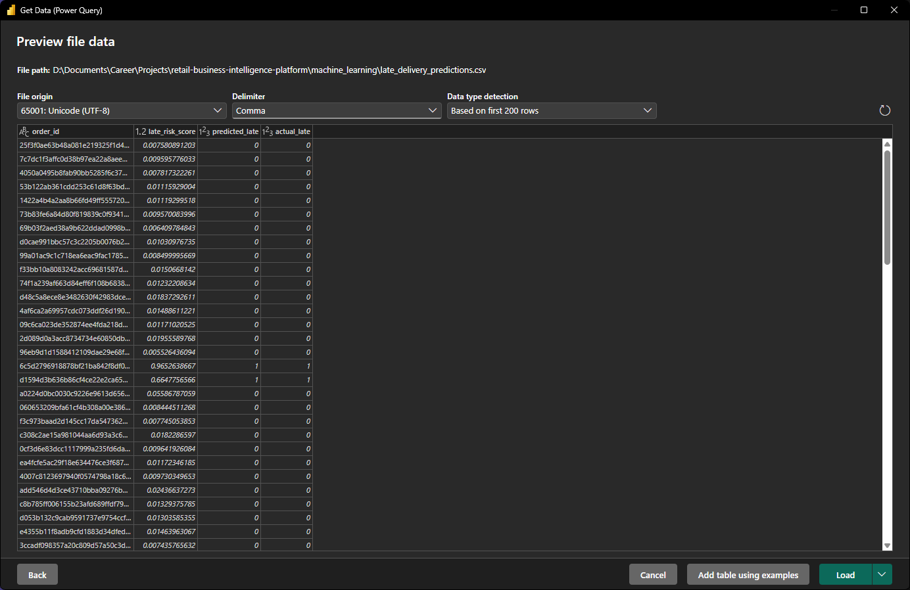

### Power Query

- Renamed the query to `late_delivery_predictions`.
- Verified column types: `order_id` (Text), `late_risk_score` (Decimal Number), `predicted_late` and `actual_late` (Whole Number).
- Prepared the dataset for integration with the existing `orders` table.

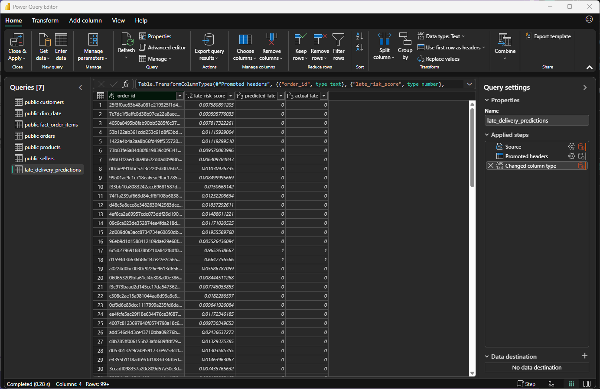


### Data Model Relationship

- Connected `late_delivery_predictions` to `public orders` using `order_id`.
- Created an active **one-to-one (1:1)** relationship with bidirectional filtering.
- Enables analysis of predicted late-delivery risk alongside existing order and customer data.

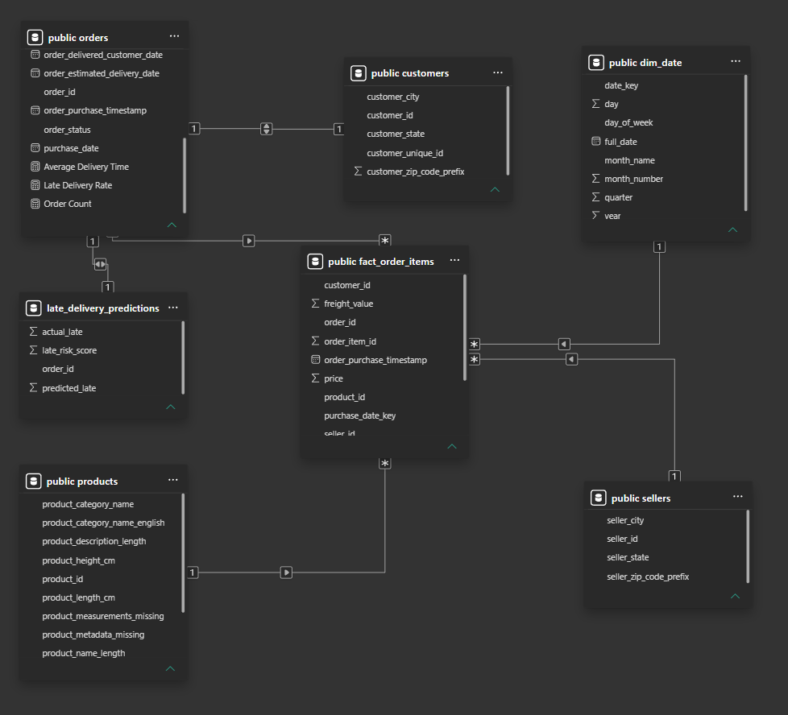


